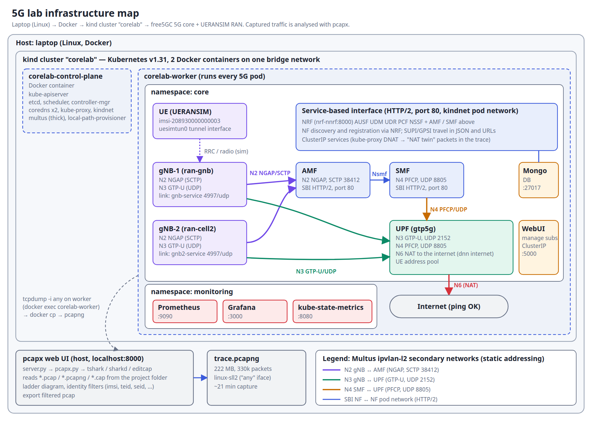

# Internal 5G Core Lab

Complete code with scripts can be provided on a request !!!
Only part of the code is available in repository - Infrastructure  - PCAP WEB UI  https://github.com/fly-hele00-dot/5G-network-pcap-visability-UI

A local, single-host lab running a full 5G Standalone core (AMF, SMF, UPF,
AUSF, UDM, UDR, PCF, NSSF, NRF, WebUI) plus a simulated RAN (gNB + UE), all
on Kubernetes (kind), so the network functions actually talk to each other
over real N1/N2/N3/N4/N6/N9 interfaces.

- **Core**: [free5GC](https://free5gc.org/) (Go implementation of 3GPP 5GC)
- **RAN simulator**: [UERANSIM](https://github.com/aligungr/UERANSIM) (simulated gNB + UE)
- **Orchestration**: Helm charts from [Orange-OpenSource/towards5gs-helm](https://github.com/Orange-OpenSource/towards5gs-helm), on a local [kind](https://kind.sigs.k8s.io/) cluster
- **Why not Open5GS**: Open5GS has no actively-maintained Kubernetes Helm chart. free5GC implements the same 3GPP network functions (AMF/SMF/UPF/etc.) and has a proven, CI-tested Helm/kind path — same architecture concepts, different codebase.

## Infrastructure



## Layout

```
lab/
  cluster/                     kind cluster config + generated network overrides
  charts/towards5gs-helm/      vendored upstream Helm charts (free5gc + ueransim)
  monitoring/                  Prometheus + kube-state-metrics + Grafana manifests
  scripts/                     ordered setup scripts (00 -> 09)
```

## Status
**Fully working end to end.** All 11 core NFs (AMF, AUSF, NRF, NSSF, PCF, SMF,
UDM, UDR, UPF, WebUI, MongoDB) run on the current official free5GC `v4.2.3`
images. UERANSIM UE registers (full 5G-AKA with SQN re-sync), establishes a
PDU session, and gets a real TUN interface (`uesimtun0`) that pings the
internet through the UPF:
```
$ kubectl -n core exec ran-ue-... -- ping -I uesimtun0 -c4 8.8.8.8
4 packets transmitted, 4 received, 0% packet loss
```

## Addressing & exposure (private, local-only)

Nothing uses the upstream/kind default ranges, and nothing is reachable from
outside this host:

| What | Range / address |
|---|---|
| kind node network (`corelab-net`, docker bridge) | `172.29.40.0/24` -- docker assigns `.0/25` only; nodes `.2`/`.3`, gateway `.1` |
| Pod CIDR / Service CIDR | `10.212.0.0/16` / `10.213.0.0/16` |
| N2 (ipvlan) | `10.10.60.248/29` -- AMF `.249`, gNB `.250`, cell2 gNB `.251` |
| N3 (ipvlan) | `10.10.60.232/29` -- UPF `.233`, gNB `.236`, cell2 gNB `.234` |
| N4 (ipvlan) | `10.10.60.240/29` -- UPF `.241`, SMF `.244` |
| N9 (ipvlan, ULCL only) | `10.10.60.224/29` |
| N6 (UPF -> data network) | UPF `10.10.40.200` on `corelab-net` |
| UE pool (DNN `internet`) | `10.60.0.0/17` (first UE gets `10.60.0.1`) |

- Kubernetes API server bound to `127.0.0.1` (`cluster/kind-cluster.yaml`).
- Every Service is `ClusterIP` -- no NodePorts (WebUI used to be NodePort 30500).
- `corelab-net` sets `host_binding_ipv4=127.0.0.1`, so a port ever published
  from it binds to loopback, not a LAN interface.
- WebUI / Grafana / Prometheus are reached only via
  `./scripts/09-open-grafana.sh`, which port-forwards with `--address 127.0.0.1`.

Names: cluster `corelab` (nodes `corelab-control-plane`, `corelab-worker`),
namespace `core`, Helm releases `core` (free5GC, pods `core-free5gc-<nf>-*`),
`ran` (pods `ran-gnb-*`, `ran-ue-*`) and `ran-cell2` (second gNB, see
`cluster/ueransim-tower2-values.generated.yaml` for its install command).

## Prerequisites 
- 20 CPU, 15GB RAM, 349GB disk, VT-x present — plenty for this lab
- `kubectl`, `kind`, `helm` installed and on PATH
- Docker installed, `gtp5g` (built from `master`, see §Issues) built and loaded, `tcpdump`/`wireshark`/`mergecap` available

## Setup order

```bash
cd "5g lab/lab"

# 1. Docker (needs sudo password interactively)
./scripts/00-install-docker.sh
# then log out/in, or: newgrp docker

# 2. gtp5g kernel module on the HOST (needs sudo password interactively)
#    Required for the UPF to actually forward GTP-U user-plane traffic.
#    Without it, control-plane signaling (AMF<->SMF<->UDM etc.) still works,
#    but PDU sessions / UE data traffic through the UPF will not.
./scripts/01-install-gtp5g.sh

# 3. Create the corelab-net docker network + kind cluster + CNI plugins + Multus
./scripts/02-create-kind-cluster.sh

# 4. Deploy free5GC (reads corelab-net's subnet for the N6 interface)
./scripts/03-deploy-free5gc.sh

# 5. Deploy UERANSIM (simulated gNB + UE) and check the PDU session comes up
./scripts/04-deploy-ueransim.sh

# Optional: second gNB (cell 2, TAC 2)
helm -n core upgrade --install ran-cell2 charts/towards5gs-helm/charts/ueransim \
  -f cluster/ueransim-tower2-values.generated.yaml --set fullnameOverride=ran-cell2

# Teardown everything (cluster + corelab-net network)
./scripts/05-teardown.sh
```

## What "communication between NFs" looks like once it's up

- **N2** (gNB <-> AMF): NGAP over SCTP
- **N1** (UE <-> AMF): NAS messages carried inside NGAP
- **N4** (SMF <-> UPF): PFCP — SMF tells the UPF how to handle a session
- **N3** (gNB <-> UPF): GTP-U — actual user data tunnel
- **N9** (UPF <-> UPF): GTP-U, used in multi-UPF / ULCL topologies
- **N6** (UPF <-> Data Network): plain IP out to the "internet" (the kind docker network here)
- Everything else (AMF<->AUSF, AMF<->UDM, SMF<->PCF, SMF<->UDM, all NFs<->NRF for discovery, etc.) is HTTP/2 + JSON Service-Based Interface (SBI) traffic — this is what your existing notes in `../5g-core-ntw.odt` describe.

Inspect it with:
```bash
kubectl -n core get pods -o wide
kubectl -n core logs deploy/core-free5gc-amf-amf
```

## Tracing traffic in Wireshark

All free5GC NF pods run as containers-in-a-container on the kind node(s)
(`corelab-control-plane`, `corelab-worker`, ...) -- every NF's traffic (SBI over
the pod network, and N2/N3/N4/N6/N9 over ipvlan on the node's eth0) is
visible from inside that node container. If NFs ever get spread across
multiple worker nodes, capture on all of them at once -- both scripts below
accept multiple node names (or `--all-kind`) and merge the streams into one
Wireshark session / one pcap file.

```bash
# Live, straight into a local Wireshark window:
./scripts/06-wireshark-live.sh                      # menu to pick node(s)
./scripts/06-wireshark-live.sh corelab-worker
./scripts/06-wireshark-live.sh --all-kind
FILTER='sctp or port 8805 or port 2152' ./scripts/06-wireshark-live.sh corelab-worker

# Or capture to a .pcap file (e.g. across a UE registration test), Ctrl-C to stop:
./scripts/07-capture-to-file.sh --all-kind
```

Useful filters per interface:
- **N2** (gNB<->AMF, NGAP): `sctp`
- **N4** (SMF<->UPF, PFCP): `port 8805`
- **N3/N9** (GTP-U user data): `port 2152`
- **SBI** (NF<->NF, HTTP/2+JSON): `tcp port 80` (this chart uses plain HTTP for SBI, see `global.sbi.scheme`)

## free5GC WebUI
ClusterIP only. Run `./scripts/09-open-grafana.sh`, then open
`http://127.0.0.1:5000` (login `admin` / `free5gc`). The UERANSIM UE's
subscriber (`imsi-208930000000003`) is provisioned automatically by
`04-deploy-ueransim.sh`; add others there matching
`charts/towards5gs-helm/charts/ueransim/values.yaml` -> `ue.configuration`.

## Monitoring (Prometheus + Grafana)

```bash
./scripts/08-deploy-monitoring.sh   # one-time (or after changing monitoring/*.yaml)
./scripts/09-open-grafana.sh        # port-forwards to 127.0.0.1 only, Ctrl-C to stop
```
- Grafana: `http://127.0.0.1:3000/d/5g-core-lab` (anonymous viewer access, no login)
- Prometheus: `http://127.0.0.1:9090`
- free5GC WebUI: `http://127.0.0.1:5000`

The dashboard (`monitoring/dashboard-5g-lab.json`) has three rows:
- **Node health** — Ready/NotReady per kind node, CPU & memory per node (via kubelet cAdvisor)
- **NF pod health** — % of free5gc pods Ready, restart counts and ready-status per pod/node (via kube-state-metrics)
- **PDU sessions (AMF)** — active PDU session count, session create/release rate, UEs by GMM state

**AMF is the only free5GC NF in this version with built-in Prometheus
metrics** (`internal/metrics/business/` in the AMF repo — PDU session,
GMM/CM state, handover, plus generic SBI/NAS/NGAP request metrics). SMF and
UPF don't expose any yet, so there's no UPF-side throughput/session metric
to show — "PDU sessions" here means AMF's view of them (active count +
create/release events), not literal per-hop packet counts. Enabled via a
`metrics:` block added to `charts/.../free5gc-amf/templates/amf-configmap.yaml`
(off by default in the upstream chart) and `prometheus.io/scrape` pod
annotations in `amf-deployment.yaml` for Prometheus to auto-discover it.

Prometheus scrapes (see `monitoring/03-prometheus-config.yaml`):
AMF's `/metrics` (pod annotation discovery, namespace `core` only),
kube-state-metrics, and each kind node's kubelet (`/metrics` and
`/metrics/cadvisor`, proxied through the K8s API — no separate
node-exporter needed).

